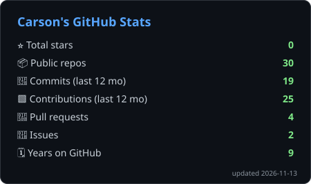
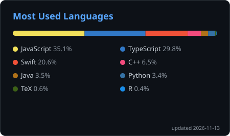

  

  
  
  
  

---

### 🧭 About me

- Ottawa 🇨🇦 (public service) -> Bordeaux 🇫🇷 (business school) -> New York 🇺🇸 (fintech) -> Montréal 🇨🇦 (sales engineering)
- 🎓 B.Sc. Biochemistry + BCS Computer Science, Carleton University + MBA, Université de Bordeaux
- 💡 Interested in the overlap of software, economics, and digital marketing
- 🪙 My hobbies include coins, history, travel, and the gym

### 🛠️ Toolbox

   
   
  

### 🚀 Recent work

| Project | What it is |
| --- | --- |
| [**soundcrest**](https://github.com/carsonfischl/soundcrest) | Live waveform of whatever your Mac is playing (Swift) |
| [**comitas-collection**](https://comitas-collection.vercel.app) | A global historiography through numismatics |
| [**csfischl**](https://csfischl.vercel.app) | My personal site: Next.js + Tailwind, English and French |

### 📊 Stats

  
  

  
  

<picture>
  <source media="(prefers-color-scheme: dark)" srcset="https://raw.githubusercontent.com/carsonfischl/carsonfischl/output/snake-dark.svg" />
  
</picture>

<!-- Stats cards are generated daily by .github/workflows/profile-stats.yml and pushed to the `output` branch. -->
